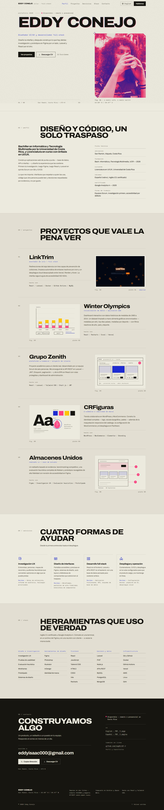
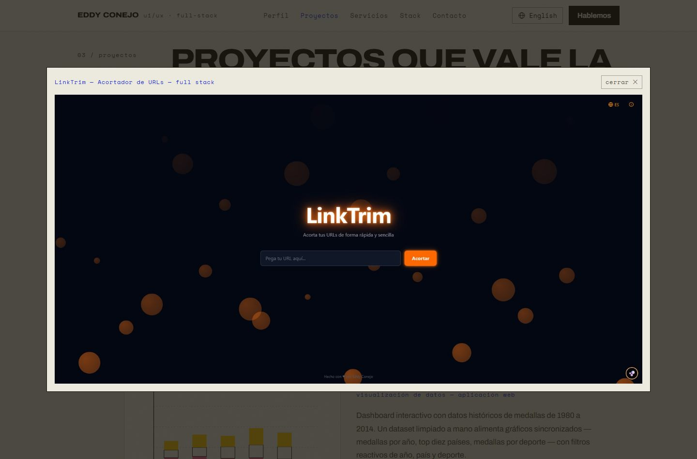

# Eddy Conejo — portafolio

Sitio de una página, bilingüe (ES/EN), para un diseñador UI/UX y desarrollador full-stack de Costa Rica. Construido con React 19, Vite y Tailwind CSS 4.

## La idea

El sitio está diseñado como un **pliego impreso en risografía**: papel hueso, dos tintas (cobalto y magenta fluorescente), retrato en duotono con trama de semitono, folios, marcas de registro y colofón. No es decoración: Eddy también hace identidad y gráfica, así que el portafolio usa el lenguaje de la imprenta —el mismo de su trabajo— en lugar del kit genérico de fondo oscuro con degradados.

Un solo gesto fuerte: el nombre a tamaño de portada y el pliego del retrato. Todo lo demás queda en silencio y se ordena con reglas finas, tipografía y espacio.




## Sistema visual

| Token | Valor | Uso |
| --- | --- | --- |
| `paper` | `#ECE9DF` | fondo base |
| `paper-deep` | `#E2DED1` | bandas de sección |
| `ink` | `#17150F` | texto, bloques de tinta |
| `muted` | `#4F4A38` | texto secundario (contraste 7.4:1) |
| `cobalt` | `#1E2BD0` | tinta 1, enlaces y acentos (7.4:1) |
| `magenta` | `#FF3D7F` | tinta 2, formas y realces |
| `sun` | `#FFC400` | tercera tinta, solo en figuras |

- **Tipografía:** Archivo variable (eje de ancho, 400–900) para display y texto; Space Mono para folios, fichas técnicas y colofón. Ningún texto de interfaz baja de 12 px, y el cuerpo va a 16 px.
- **Dispositivos estructurales:** numeración de sección (01–06) como folios reales del documento, reglas de 1 px, fichas técnicas con `dl`, pies de figura.
- **Textura:** grano de papel en overlay fijo y trama de semitono sobre el retrato.
- **Registro imperfecto:** el nombre y los títulos llevan un desplazamiento de las dos tintas, como una prueba de imprenta mal registrada.

## Contenido

- Copy bilingüe real, derivado del CV de Eddy (`public/Eddy-Conejo_CV_EN.pdf` y `..._ES.pdf`): formación, certificaciones, stack y proyectos.
- Los cinco proyectos se presentan como pliegos numerados; cada uno lleva una figura SVG dibujada a mano (no capturas falsas): la ruta de redirección de LinkTrim, el gráfico de medallas, el escaparate de Grupo Zenith, el kit de identidad de CRFiguras y el wireframe anotado de Almacenes Unidos.
- La ficha de perfil sustituye las cifras de vanidad ("1+ años", "∞ café") por datos verificables.
- El perfil de GitHub ([github.com/neg4nin9](https://github.com/neg4nin9)) es el único enlace social, en la sección de contacto.

## Capturas de proyectos

Los dibujos son el estado por defecto, no el definitivo. Para sustituir uno por una captura real basta con dejar el archivo en **`src/assets/projects/`** con el nombre del proyecto; el sitio lo detecta en el build y quita el dibujo. Ver [src/assets/projects/README.md](src/assets/projects/README.md).

| Proyecto | Archivo |
| --- | --- |
| LinkTrim | `linktrim.jpg` ✅ *(incluida)* |
| Winter Olympics | `winter-olympics.jpg` |
| Grupo Zenith | `grupo-zenith.jpg` |
| CRFiguras | `crfiguras.jpg` |
| Almacenes Unidos | `almacenes-unidos.jpg` |

Formato: 1600 px de ancho, cualquier proporción horizontal (se recorta a 16:10), JPG o WebP por debajo de 400 KB. Las capturas van a color; el duotono es solo del retrato.

Una captura se puede **abrir a tamaño completo** con clic o teclado: se muestra en un `<dialog>` nativo (Escape, clic fuera y retorno de foco incluidos), porque a 426 px de ancho la letra de una interfaz no se lee.



## Accesibilidad y rendimiento

- Enlace de salto, `main` semántico, un solo `h1`, jerarquía de encabezados correcta.
- Foco visible global, `aria-expanded` y cierre con Escape en el menú móvil, `aria-current` en la navegación por scroll.
- Idioma persistido en `localStorage`, aplicado antes del primer pintado y sincronizado con `<html lang>` y el `<title>`.
- `prefers-reduced-motion` desactiva todas las animaciones y el scroll suave.
- Contraste AA en texto pequeño; la magenta solo se usa en cuerpos grandes y formas.
- Sin dependencias de iconos por CDN: los logos de tecnología se sustituyeron por un índice tipográfico, y los glifos son SVG propios. Se eliminó `lucide-react`.

## Comandos

```bash
npm install
npm run dev     # servidor de desarrollo
npm run build   # build de producción
npm run lint    # oxlint
```

## Estructura

```
src/
  App.jsx              composición de la página + filtro de duotono
  index.css            sistema de diseño (tokens, capas, material impreso)
  i18n.js              todo el copy ES/EN
  LangContext.jsx      idioma, persistencia y metadatos del documento
  site.js              email, GitHub, CVs, ids de sección y slugs de proyecto
  projectImages.js     capturas reales por nombre de archivo (fallback: dibujo)
  assets/projects/     capturas de proyectos (ver README dentro)
  components/
    Navbar.jsx         barra fija, scroll-spy, botón de idioma, menú móvil
    Hero.jsx           portada: nombre, retrato duotono, marcas de registro
    About.jsx          perfil y ficha técnica
    Work.jsx           pliegos de proyectos
    PlateFigures.jsx   las cinco figuras SVG
    Services.jsx       servicios y entregables
    Skills.jsx         índice del stack
    Contact.jsx        contacto, copiar email, CVs
    Footer.jsx         colofón
```
